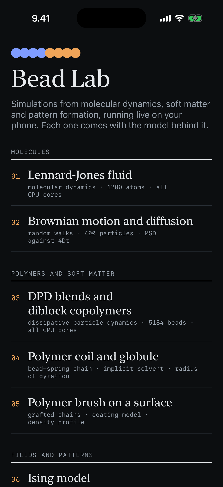
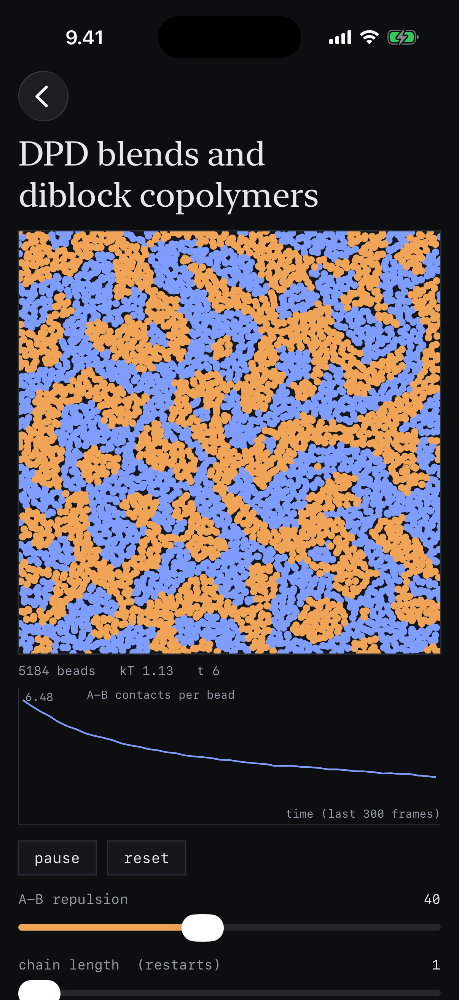
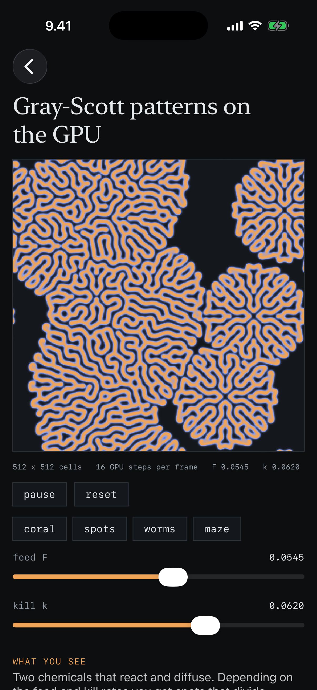

# bead-lab

An iPhone app that runs simulations from molecular dynamics, soft matter and pattern formation live on the phone, each with a short explanation of the model behind it. Written in Swift with SwiftUI, with Metal for the GPU simulation.

## Question
How much real simulation fits in a phone? Can a phone run the same kind of models that run on clusters (MD, DPD, Monte Carlo, phase-field) fast enough to play with, and can that be used to teach them?

## Approach
Eight simulations, written from scratch:

| | Simulation | Method | Size |
|---|---|---|---|
| 1 | Lennard-Jones fluid | MD, velocity Verlet, Langevin thermostat, cell lists | 1200 atoms |
| 2 | Brownian motion | overdamped Langevin, MSD against 4Dt | 400 particles |
| 3 | DPD blends and diblock copolymers | Groot-Warren DPD, harmonic bonds | 5184 beads |
| 4 | Polymer coil and globule | bead-spring chain, WCA plus tunable attraction | 80 beads |
| 5 | Polymer brush on a surface | grafted bead-spring chains, soft wall | up to 512 beads |
| 6 | Ising model | Metropolis Monte Carlo | 192 x 192 |
| 7 | Cahn-Hilliard phase separation | explicit finite differences | 128 x 128 |
| 8 | Gray-Scott reaction-diffusion | Metal compute shader on the GPU | 512 x 512 |

The particle simulations split their force loops over all CPU cores. Every simulation has sliders, a live plot of one observable (g(r), MSD, radius of gyration, density profile, magnetization, domain size) and touch interaction.

## Result
  

On a 4-core laptop-class CPU one frame of any CPU simulation takes 2 to 7 ms, well inside the 16 ms a 60 Hz screen allows, and an iPhone chip is in the same range. The engine has unit tests that check the physics: the LJ and DPD thermostats hold their temperature, Brownian MSD gives back the set D, DPD blends demix at high a_AB, a chain collapses in poor solvent, and Cahn-Hilliard conserves mass and coarsens.

## Why it matters
Simulation methods are easier to understand when a change of parameter shows its effect at once. The same code shows how to write fast numerical code (cell lists, multi-core loops, a GPU kernel) in a compiled language.

## Layout
```
BeadLab/Engine/   the simulations, plain Swift, no UI
BeadLab/Views/    SwiftUI screens and drawing
BeadLab/GPU/      the Metal shader and its view
Tests/            engine tests (swift test)
project.yml       Xcode project description (XcodeGen)
```

## Run it
On a Mac with Xcode 16 or newer:
```
brew install xcodegen
xcodegen generate
open BeadLab.xcodeproj
```
In Xcode, click the BeadLab project in the sidebar, then target BeadLab > Signing & Capabilities, and pick a Personal Team (add an Apple Account first under Xcode > Settings > Apple Accounts). Choose the iPhone in the device menu at the top of the window and press Run. On the phone, turn on Settings > Privacy & Security > Developer Mode when asked. The engine tests run anywhere Swift is installed with `swift test`.
